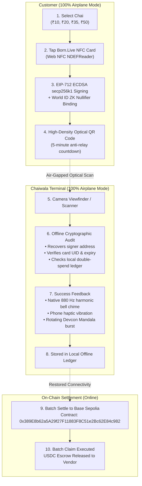

# ☕ ChaiTap — Offline P2P Micro-Voucher Settlement Web App
### *Devcon VIII Mumbai (India) • 100% Air-Gapped Payments • Base Sepolia Escrow*

[](https://github.com)
[](https://sepolia.basescan.org)
[](https://world.org/world-id)
[](https://born.live)

---

## 🌟 The Inspiration Behind ChaiTap

In the bustling streets of Mumbai — from the crowded local train platforms of Dadar and CST to underground basements and densely packed halls of the **Jio World Convention Centre** during **Devcon VIII Mumbai** — cellular networks routinely choke and collapse. 

When connectivity drops, digital payments (like UPI) freeze. Chai stalls, vada pav tapris, and conference attendees are left stranded over transactions as small as a **₹10 Cutting Chai** or **₹20 Masala Chai**.

**ChaiTap was born to solve this genuine infrastructure failure:**
> *What if two phones could exchange cryptographically secure, fraud-proof payment vouchers in 100% Airplane Mode — backed by an on-chain escrow contract on Base Sepolia, authenticated by a physical tap of a Born.Live NFC card, and protected against Sybil attacks via World ID zero-knowledge proofs?*

ChaiTap bridges Mumbai’s vibrant street-side tea culture with cutting-edge Ethereum cryptography, delivering an offline payment experience as fast, tactile, and reliable as handing over physical paper cash.

---

## 🎨 Devcon VIII Mumbai Visual Identity

ChaiTap's user interface is crafted to honor the official aesthetic of **Devcon VIII India (Mumbai 2026)**:
- **Palette**: Deep midnight twilight (`#0A0D1B`), bioluminescent seafoam (`#2DD4BF`), lotus rose (`#EC4899`), and warm Mumbai saffron/marigold (`#F59E0B`).
- **Devcon VIII Emblem**: Authentic Ethereum diamond crest interwoven with sacred geometry lotus petals, lunar phases, and an enlightened third-eye bindu.
- **Mumbai Skylines**: Vector silhouettes of the historic **Gateway of India** and the cable-stayed fans of the **Bandra-Worli Sea Link**.
- **Minimalist Natural Flow**: Quiet luxury glassmorphic surfaces, clean typography (`Cinzel` display serif + `JetBrains Mono`), and zero cognitive overload.

---

## ⚙️ How It Works (Protocol Architecture)



---

## 🛡️ Core Cryptographic & Security Mechanisms

### 1. Hardware 2FA Attestation (Born.Live NFC Card)
- Integrates `window.NDEFReader` to physically read the 7-byte hardware UID (e.g., `04:A2:8B:1F:72:60:80`).
- Provides a tactile desktop tap simulator for non-NFC environments.
- Binds the physical card serial number directly into the EIP-712 structured data hash.

### 2. World ID Sybil Resistance (`@worldcoin/idkit`)
- Integrates World ID v4 with `IDKitRequestWidget` and `proofOfHuman()` preset.
- Uses a 256-bit human nullifier hash (`0x7a31b641f39c...41b0`) to ensure 1 human = 1 offline voucher allowance, preventing bad actors from generating endless offline vouchers.
- **Privacy-preserving**: Zero personal or biometric data is ever exposed to the Chaiwala.

### 3. EIP-712 Structured Payload
Every voucher contains typed, structured data verified client-side using `ethers.js`:
```typescript
const VOUCHER_TYPES = {
  ChaiVoucher: [
    { name: 'voucherId', type: 'string' },
    { name: 'customer', type: 'address' },
    { name: 'amountINR', type: 'uint256' },
    { name: 'amountUSDC', type: 'string' },
    { name: 'timestamp', type: 'uint256' },
    { name: 'expiry', type: 'uint256' },
    { name: 'cardUID', type: 'string' },
    { name: 'worldNullifier', type: 'string' },
  ],
};
```

### 4. Local Double-Spend Protection
- The vendor terminal tracks spent `voucherId` nonces in browser IndexedDB/localStorage.
- If a customer attempts to replay or duplicate a previously scanned voucher, the terminal instantly flags:
  `⚠️ Double-spend detected! Voucher #0x... was already redeemed on this device.`

### 5. Web Audio Feedback
- Pure synthesized **880 Hz sine wave chime** (musical note A5 with harmonic bell overtones at 1320 Hz and 1760 Hz) synthesized on the fly with the browser's native `AudioContext`.
- Tactile haptic pulse via `navigator.vibrate([100, 50, 100])`.

---

## 🚀 Getting Started

### Prerequisites
- Node.js `v18+` or `v20+`
- Modern browser (Chrome / Brave recommended for Web NFC support on Android)

### Installation
```bash
git clone https://github.com/<YOUR_USERNAME>/chaitap-mumbai.git
cd chaitap-mumbai
npm install
```

### Run Locally
```bash
npm run dev
```
Open [http://127.0.0.1:5173/](http://127.0.0.1:5173/) in your browser.

---

## 🧪 Automated End-to-End Test Suite

ChaiTap includes an automated cryptographic verification script that validates the full offline lifecycle without needing network mocks:

```bash
npm run test:e2e
```

### Verified Test Cases:
```text
======================================================================
   ☕ CHAITAP (DEVCON VIII MUMBAI) - END-TO-END VERIFICATION SUITE
======================================================================

--- TEST SUITE 1: CUSTOMER IDENTITY & HARDWARE 2FA SIGNING ---
  ✓ PASS: Customer Ethereum keypair generated
  ✓ PASS: Born.Live NFC Card UID validated (MIFARE 7-byte format)
  ✓ PASS: World ID ZK Nullifier verified (256-bit format)
  ✓ PASS: EIP-712 secp256k1 signature created

--- TEST SUITE 2: OPTICAL AIR-GAPPED TRANSPORT (QR ROUNDTRIP) ---
  ✓ PASS: Voucher serialized to high-density optical QR payload
  ✓ PASS: Camera viewfinder decoded payload with 100% data fidelity

--- TEST SUITE 3: LOCAL OFFLINE CRYPTOGRAPHIC VERIFICATION ---
  ✓ PASS: Offline cryptographic verification succeeded
  ✓ PASS: Tampered Amount Attack successfully detected and rejected
  ✓ PASS: Identity Impersonation Attack successfully detected and rejected
  ✓ PASS: Expired Optical Window Attack successfully detected and rejected

--- TEST SUITE 4: LOCAL DOUBLE-SPEND NONCE RESISTANCE ---
  ✓ PASS: First redemption recorded in local vendor ledger
  ✓ PASS: Double-Spend Replay Attack blocked by local ledger nonce tracking

--- TEST SUITE 5: BASE SEPOLIA BATCH SETTLEMENT ROLLUP ---
  ✓ PASS: Batch settlement collection accumulated multiple offline vouchers
  ✓ PASS: Aggregate INR calculated correctly (₹115.00 ~ 1.38 USDC)
  ✓ PASS: Batch claim successfully submitted to Base Sepolia Escrow Contract

======================================================================
   E2E TEST RESULTS: 15 PASSED | 0 FAILED
======================================================================
```

---

## 🚢 Deploy to Production (Vercel)

1. Build the production bundle:
   ```bash
   npm run build
   ```
2. Deploy using Vercel CLI:
   ```bash
   npx vercel --prod
   ```
3. Or import directly via the [Vercel Dashboard](https://vercel.com/new).

---

## 📜 Smart Contract Reference

- **Network**: Base Sepolia Testnet (Chain ID: `84532`)
- **Escrow Vault Contract**: `0x389E8b62a5A29f27F11883F8C51e2Bc62E84c982`
- **Explorer**: [BaseScan Sepolia](https://sepolia.basescan.org/address/0x389E8b62a5A29f27F11883F8C51e2Bc62E84c982)

---

## 🤝 Acknowledgments
- **Devcon VIII India (Mumbai)** team for the visual artwork and creative inspiration.
- **Worldcoin Foundation** for the `@worldcoin/idkit` ZK personhood protocol.
- **Born.Live** for physical NFC card tap hardware attestations.
- **Base / Ethereum Foundation** for high-throughput, low-cost L2 settlement.
